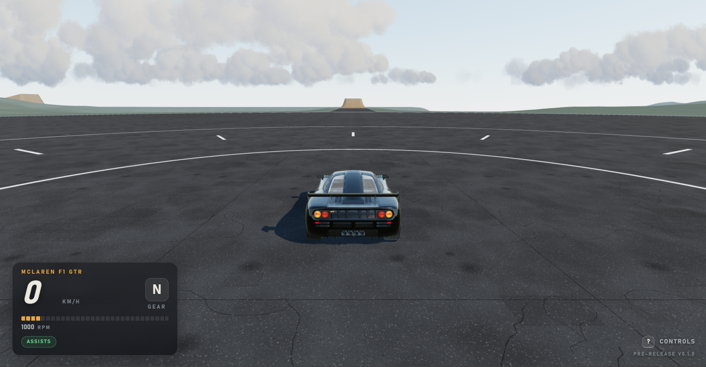
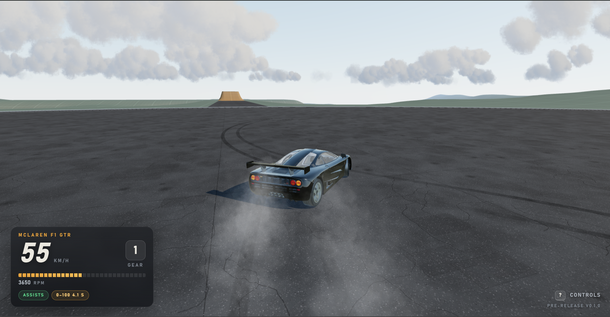
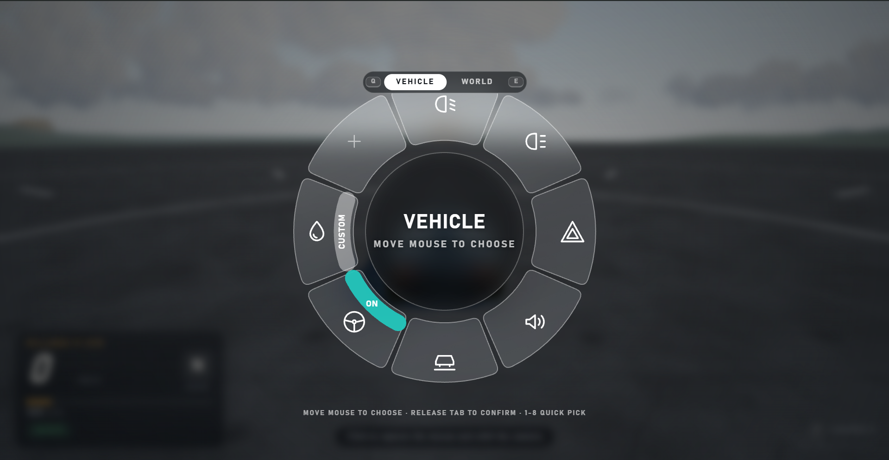
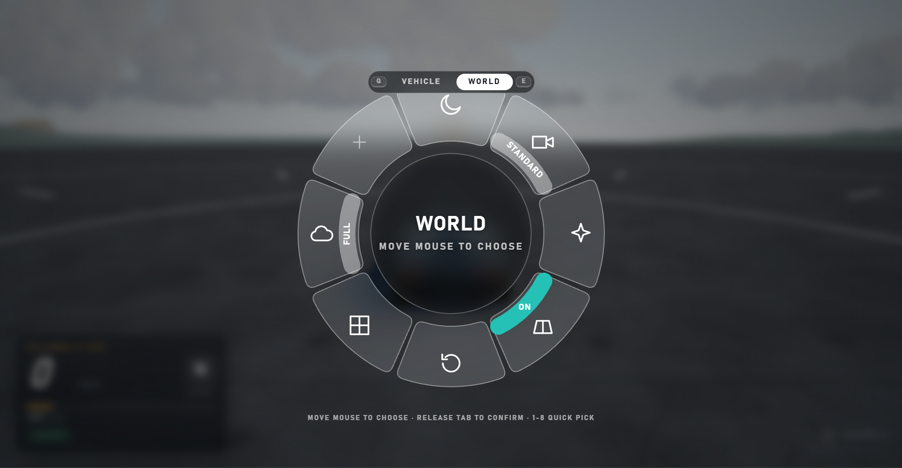

# A Driving Sim in Your Browser

A drivable 3D car sim that runs entirely in your browser. No install, no launcher, just open it and drive.



## Features

- **Drivable McLaren F1 GTR** with a live HUD showing speed, gear, RPM and a 0–100 km/h timer
- **Engine model** with RPM, clutch behaviour, free revving and a rev limiter
- **Tyre smoke and skid marks** that build up as the tyres lose grip
- **Radial wheel menu** for quick access to vehicle and world options
- **Driver assists** you can toggle on or off
- **Open test area** with road markings, sky and clouds
- **Pure web tech**: built with three.js, nothing to install



## Radial Wheel Menu

Hold **Tab** to open the wheel, move the mouse to choose, and release **Tab** to confirm. Press **1–8** for a quick pick, and **Q / E** to switch between the two pages.

| Vehicle | World |
|---|---|
|  |  |

**Vehicle** page: headlights, hazard lights, sound, ride options, steering assist and tyre smoke settings.

**World** page: camera mode, cloud quality, road and ground options, and a reset.

## Getting Started

1. Download or clone this repository.
2. Open `index.html` in your browser.
3. If the car or textures don't load, serve the folder locally instead, since some browsers block local file loading:
   ```
   python -m http.server 8000
   ```
   Then visit `http://localhost:8000`.
4. Click the game to capture the mouse, and press the **?** CONTROLS button in the corner for the full key list.

## Status

Pre-release **v0.1.0**. Expect rough edges, and more cars, tracks and features over time.

## Built With

- [three.js](https://threejs.org/)
- Plain HTML, CSS and JavaScript
